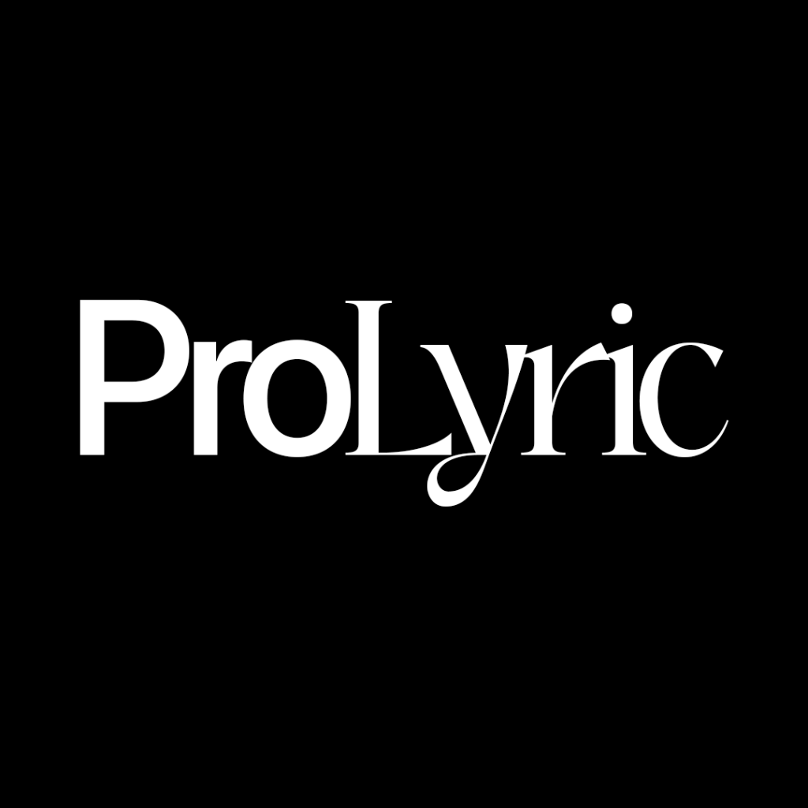

# ProLyric

<p align="center">
  
</p>

<p align="center">
  <strong>High-performance, keyboard-first lyric generator for Renewed Vision ProPresenter 7+</strong><br>
  Single & Dual-language presentations • 100% offline Malayalam-to-Manglish transliteration • SongDB hymn search • Instant .pro export
</p>

<p align="center">
  <a href="https://dotnet.microsoft.com/download/dotnet/8.0"></a>
  
  
  
  
  <a href="LICENSE"></a>
</p>

---

## Overview

**ProLyric** is a purpose-built desktop application designed to streamline church media preparation. Creating bilingual, dual-language, or single-language hymn and worship presentations for **Renewed Vision ProPresenter 7+** traditionally requires hours of manual copy-pasting, line splitting, transliterating, and formatting.

ProLyric turns this workflow into a seconds-long, keyboard-driven experience: import lyrics from SongDB databases, paste unstructured text, auto-transliterate Malayalam to Manglish with a single keystroke, split slides on the fly, and export directly into native `.pro` presentation files with zero dialog clutter.

```
┌────────────────────────────────────────────────────────────────────────┐
│                              PROLYRIC                                  │
│                                                                        │
│   [ SongDB Search ]  ──┐                                               │
│   [ Bulk Paste Text ] ─┼─► [ Smart Slide Editor ] ─► [ Native .pro ]   │
│   [ Direct Typing ]  ──┘          │                         │          │
│                                   ▼                         ▼          │
│                       [ Ctrl+Shift+T Transliterate ]  [ ProPresenter ] │
│                        (Malayalam ➔ Manglish)         (7.0 - 7.16+)    │
└────────────────────────────────────────────────────────────────────────┘
```

---

## Key Features

### 🚀 Direct ProPresenter 7+ Generation
* **Binary Protobuf Serialization**: Builds official `.pro` files with internal Google Protocol Buffer binary schemas.
* **Fully Compatible**: Works out-of-the-box with ProPresenter 7.0 through latest releases on both Windows and macOS.
* **Built-in Zero-Config Template**: Includes an internal 54pt centered default layout—no external template files required to start generating presentations immediately.
* **Custom Template Support**: Optionally connect any custom `.pro` file using standard `Lang1` and `Lang2` slide layers to preserve your church's custom fonts, margins, positions, and styling.

### 🌐 Dual-Language & Offline Transliteration
* **Single & Dual-Language Modes**:
  * **Single Lang**: Clean, focused presentation for Malayalam, English, or any single language.
  * **Dual Lang**: Stacked bilingual slides featuring primary text (`Lang1`) and secondary phonetics (`Lang2`).
* **Instant Transliteration (`Ctrl + Shift + T`)**: Automatically converts all Malayalam lyrics across every slide into phonetic Manglish in milliseconds.
* **100% Offline & Private**: Runs entirely on your local machine using customized phonetic linguistic algorithms—no internet connection, cloud APIs, or external dependencies required.
* **Linguistic Accuracy**: Handles complex Malayalam phonetics including chillu letters (*ർ, ൽ, ൾ, ൻ, ൺ*), samvruthokaram word-final vowels, anusvara assimilation (*ഗംഗ ➔ Ganga*), and conjunct ligatures.

### 📖 SongDB & Hymn Database Search (`Ctrl + D`)
* **Multi-Format Support**: Connects to SQLite (`.db`, `.sqlite`) and XML song databases.
* **Intelligent Query Matching**: Search hymns by Malayalam title, English transliteration, full lyrics, or song number.
* **Flexible Number Syntax**: Supports queries like `25`, `#25`, `Song 25`, `No. 25`, or `Hymn 25` with instant exact-match prioritization.
* **One-Click Import**: Automatically structures stanzas and splits songs into ready-to-present slides.

### ⚡ Keyboard-First, Non-Intrusive UX
* **Clean Status Indications**: No interrupting popup confirmation dialogs. All save, export, transliteration, and error notifications appear smoothly in the bottom-left status bar.
* **IME & Language Switcher Safe**: Global shortcuts function seamlessly whether typing in English, Unicode Malayalam, or using Windows IME layouts.
* **Precision Slide Splitting**:
  * <kbd>Ctrl</kbd> + <kbd>Enter</kbd>: Splits the active slide at cursor position.
  * <kbd>Ctrl</kbd> + <kbd>Click</kbd>: Splits the active slide directly at the clicked word or character.
* **Bulk Paste (`Ctrl + B`)**: Paste entire songs from websites or text documents with automatic stanza detection by blank lines or fixed line counts.

### 🎨 Theme-Proof RTF Typography
* ProLyric injects standardized Rich Text Format control words (`\pard`, `\fN`, `\fsN`, `\cfN`, `\qc`) for every line.
* When your church AV team applies a custom ProPresenter Theme during service, fonts adapt uniformly without shrinking, distortion, or missing character tags.

---

## Keyboard Shortcuts

ProLyric is built for rapid, mouse-free operation:

| Shortcut | Action | Description |
| :--- | :--- | :--- |
| <kbd>Ctrl</kbd> + <kbd>N</kbd> | **New Song** | Start a fresh presentation with a clean slide |
| <kbd>Ctrl</kbd> + <kbd>S</kbd> | **Save to Library** | Persist song project to local SQLite library (no dialog popups) |
| <kbd>Ctrl</kbd> + <kbd>E</kbd> | **Export .pro** | Export native ProPresenter presentation file |
| <kbd>Ctrl</kbd> + <kbd>Shift</kbd> + <kbd>T</kbd> | **Transliterate All** | Convert all Malayalam slides to Manglish (auto-activates Dual Mode) |
| <kbd>Ctrl</kbd> + <kbd>T</kbd> | **Transliterate Current** | Transliterate only the currently selected slide |
| <kbd>Ctrl</kbd> + <kbd>Enter</kbd> | **Split Slide at Cursor** | Break slide into two consecutive slides at the cursor position |
| <kbd>Ctrl</kbd> + <kbd>Click</kbd> | **Split Slide at Mouse** | Click anywhere in the text editor to split at that position |
| <kbd>Ctrl</kbd> + <kbd>O</kbd> | **Open Library** | Browse and load previously saved songs |
| <kbd>Ctrl</kbd> + <kbd>D</kbd> | **Open SongDB** | Search and import from connected hymn databases |
| <kbd>Ctrl</kbd> + <kbd>B</kbd> | **Bulk Paste** | Open bulk paste parser for multi-stanza lyric imports |
| <kbd>Ctrl</kbd> + <kbd>M</kbd> / <kbd>Insert</kbd> | **Add Slide** | Append a new slide to the presentation |
| <kbd>Alt</kbd> + <kbd>▲</kbd> | **Move Slide Up** | Reorder current slide up in the sequence |
| <kbd>Alt</kbd> + <kbd>▼</kbd> | **Move Slide Down** | Reorder current slide down in the sequence |

---

## Quick Workflow Guide

### Creating a Bilingual Presentation in 30 Seconds

1. **New Song**: Press <kbd>Ctrl</kbd> + <kbd>N</kbd> and enter the song title (or let it auto-detect from the first line).
2. **Add Lyrics**:
   * *Option A*: Press <kbd>Ctrl</kbd> + <kbd>D</kbd> to find and import the song from SongDB.
   * *Option B*: Press <kbd>Ctrl</kbd> + <kbd>B</kbd>, paste raw lyrics, and choose paragraph splitting.
   * *Option C*: Type or paste Malayalam lyrics directly into the **Language 1** text editor.
3. **Transliterate**: Press <kbd>Ctrl</kbd> + <kbd>Shift</kbd> + <kbd>T</kbd>. ProLyric instantly transliterates every slide into Manglish and displays the secondary text box.
4. **Adjust Slides**: Review slide lengths. If a slide has too many lines, place the cursor and press <kbd>Ctrl</kbd> + <kbd>Enter</kbd> to split it cleanly.
5. **Export**: Press <kbd>Ctrl</kbd> + <kbd>E</kbd>. Select your destination folder, and your `.pro` file is ready to drop into ProPresenter!

---

## Custom Template Configuration (Optional)

ProLyric includes an internal built-in template that renders 54pt centered white text. If you want custom screen styling:

1. Open **ProPresenter 7+** and create a presentation (e.g. `CustomTemplate.pro`).
2. Add text boxes on a slide and rename the layers:
   * **`Lang1`** *(case-insensitive)*: Primary lyric layer (Malayalam / Main language).
   * **`Lang2`** *(case-insensitive)*: Secondary lyric layer (Manglish / English).
3. Customize position, typography, colors, shadows, and text alignment.
4. Export the presentation and select it in ProLyric via the template picker.

ProLyric clones your custom layer geometry, styling, and formatting across all generated slides.

---

## Getting Started

### Prerequisites

* **Operating System**: Windows 10 (version 19041+) or Windows 11 (64-bit)
* **Installer**: Zero dependencies (Fully self-contained, .NET runtime included)
* **For Building from Source**: [.NET 8.0 SDK](https://dotnet.microsoft.com/download/dotnet/8.0) or newer (supports .NET 8 / 9 / 10)

### Building from Source

```powershell
# Clone the repository
git clone https://github.com/git-itsjoel/ProLyric.git
cd ProLyric

# Restore dependencies & build
dotnet build

# Run the application
dotnet run --project ProLyric
```

### Running Unit Tests

ProLyric includes an automated test suite covering Protobuf serialization, RTF Unicode encoding, phonetic transliteration, SQLite queries, and SongDB search parsers:

```powershell
dotnet test
```

### Compiling Windows Installer (`.exe`)

ProLyric includes an automated build script powered by [Inno Setup 6](https://jrsoftware.org/isinfo.php):

```powershell
powershell -ExecutionPolicy Bypass -File .\build-installer.ps1
```

The compiled standalone setup installer is generated in `dist\ProLyric-Setup.exe`.

---

## Architecture & Project Structure

```text
ProLyric/
├── ProLyric/                          # WPF .NET 8 Desktop Application
│   ├── Assets/                        # Branding, logos, and high-DPI application icons
│   ├── Models/                        # Core data models
│   │   ├── AppSettings.cs             # Application configuration model
│   │   ├── LanguageMode.cs            # Single vs. Dual language enum
│   │   ├── LyricSlide.cs              # Slide data model with section & language properties
│   │   └── SongProject.cs             # Full song presentation project structure
│   ├── Protos/                        # Official ProPresenter 7+ Protocol Buffer definitions
│   │   ├── presentation.proto         # Presentation cues, actions, and slide groups
│   │   ├── slide.proto                # Visual elements, text components, and builds
│   │   └── ...                        # Extended RVProtoData schemas
│   ├── Services/                      # Application business logic
│   │   ├── ProPresenterService.cs     # .pro protobuf presentation generator & template cloner
│   │   ├── RtfUnicodeEncoder.cs       # RTF Unicode character replacement & paragraph formatter
│   │   ├── MalayalamTransliteratorService.cs # Offline Malayalam-to-Manglish phonetic engine
│   │   ├── SongDbService.cs           # SQLite & XML hymn database query provider
│   │   ├── SongLibraryDbService.cs    # Local SQLite song repository manager
│   │   ├── LyricParserService.cs      # Stanza chunking & title resolution engine
│   │   └── SettingsService.cs         # Settings manager (%AppData%\ProLyric)
│   ├── ViewModels/                    # MVVM view models (CommunityToolkit.Mvvm)
│   │   ├── MainViewModel.cs           # Core application state, commands, and operations
│   │   ├── SlideViewModel.cs          # Slide view model with live preview formatting
│   │   └── Converters.cs              # XAML UI value converters
│   └── Views/                         # XAML UI windows & dialogs
│       ├── BulkPasteDialog.xaml       # Multi-stanza raw lyric importer
│       ├── LibraryDialog.xaml         # Local song library browser
│       └── SongDbDialog.xaml          # SongDB hymn database search & import interface
├── ProLyric.Tests/                    # Comprehensive xUnit test suite (81 tests)
├── build-installer.ps1                # Automated release & installer build script
├── installer.iss                      # Inno Setup 6 script configuration
├── ProLyric.slnx                      # Modern .NET solution file
└── README.md
```

---

## Acknowledgments & Credits

ProLyric is made possible thanks to these open-source projects:

* **[greyshirtguy/ProPresenter7-Proto](https://github.com/greyshirtguy/ProPresenter7-Proto)**: Protocol Buffer definitions reverse-engineered for Renewed Vision ProPresenter 7+.
* **[knadh/ml2en](https://github.com/knadh/ml2en)** by Kailash Nadh: Foundational phonetic vowel and consonant transliteration mappings.
* **[Ajishkbn/aksharam](https://github.com/Ajishkbn/aksharam)** by Ajish: Advanced Malayalam phonetic syllable parsing, chillu letters, and contextual conjunct handling.

---

## License

Distributed under the **MIT License**. See [`LICENSE`](LICENSE) for full details.

<p align="center">
  <sub>made with 🤍 by joe!</sub>
</p>
